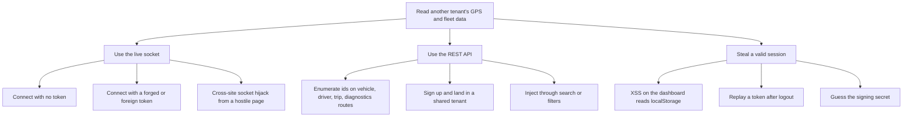

# Attack tree: Iran-Zubie

Method: root goal, OR and AND branches, leaves annotated with cost, skill and detectability, each
mapped to a control and a status. Share only with people who work on this project.

Leaf annotations: **cost** low or high, **skill** low, medium or high, **detect** whether the blue team sees it in the logs today.

## Goal 1: read another organization's fleet data

| Leaf | Cost | Skill | Detect | Control | Status |
|---|---|---|---|---|---|
| A1 anonymous socket | low | low | yes (`ws refused`) | Token subprotocol, 403 before accept | Closed, probe WS-1 |
| A2 forged or foreign token | low | medium | yes | Signature, issuer, audience, expiry checks; per-organization stream | Closed, probes AUTH-1, WS-2, WS-5 |
| A3 cross-site hijack | low | medium | yes | `Origin` allow-list on the socket | Closed, probe WS-3 |
| B1 id enumeration | low | low | partly (404 bursts in access log) | Every query filtered by organization, diagnostics joined to vehicle | Closed, probe TENANT-2 |
| B2 shared tenant on sign-up | low | low | yes (`auth.register`) | Own organization per sign-up | Closed, probe TENANT-1 |
| B3 injection | low | medium | partly | ORM bind parameters, `Literal` enums, length limits | Closed, probes INJ-1, INJ-2 |
| C1 XSS steals token | medium | high | no | React text rendering, CSP, no HTML sinks, escaped marker icons | **Mitigated, not closed** (token in `localStorage`) |
| C2 replay after logout | low | low | yes | `jti` revocation list | Closed within one process, probe SESS-1 |
| C3 guess the secret | high | medium | yes (failures) | 32+ character secret enforced in production | Closed, probe AUTH-1 |

## Goal 2: take over a tenant account

| Path | Leaf | Control | Status |
|---|---|---|---|
| OR | Online password guessing | Per-IP and per-account limits, 429 with `Retry-After` | Closed, probe AUTH-5 (trade-off: account lock-out) |
| OR | User enumeration, then targeted guessing | Identical 401 body, equalised hashing time | Closed, probe AUTH-3 |
| OR | Weak password at sign-up | 10 character minimum, common passwords refused | Closed |
| OR | Known demo credentials in production | Demo seeding off in production, UI never prints them | Closed |
| OR | Forge a token with a known secret | Production refuses placeholders | Closed |
| OR | Over-long password to crash hashing | 72-byte guard | Closed, probe AUTH-4 |

## Goal 3: change data without permission

| Path | Leaf | Control | Status |
|---|---|---|---|
| OR | Viewer acknowledges alerts or edits geofences | `require_role("manager")` on four routes | Closed, test |
| OR | Mass assignment of `role` or `organization_id` | Inbound models reject unknown fields | Closed, probe TENANT-4 |
| OR | Mutate another tenant's rows by id | Organization filter on every write | Closed, probe TENANT-3 |
| OR | Spreadsheet formula injection in an exported report | Cell sanitising | Closed |

## Goal 4: deny service

| Path | Leaf | Control | Status |
|---|---|---|---|
| OR | Huge request body | 256 KB cap, 413 before reading | Closed, probe INJ-4 |
| OR | Unbounded `limit` or `days` | Query bounds, 422 | Closed, probe INJ-3 |
| OR | Open thousands of sockets | Global and per-user caps, idle and expiry close, send timeout | Closed |
| OR | Slow or stalled socket client | Concurrent sends with timeout; slow clients dropped | Closed |
| OR | Flood the lead form | 5 per hour per IP | Closed |
| OR | Distributed flood from many IPs | Per-IP limits do not help | **Open.** Needs an edge limiter or WAF in front. |

## Highest-value remaining work

1. Cookie-based session (removes C1 as a token-theft path).
2. Redis-backed limits and revocation (removes the single-process caveats).
3. Edge rate limiting for distributed floods.
