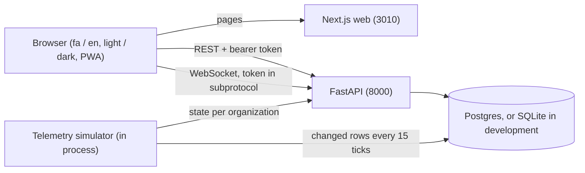

# Implementation report: FastAPI and Next.js

A connected-car and fleet-telematics web app, Persian first with full English, light and dark themes,
responsive from 390 px. This document describes what exists, how it fits together, and how to run it.

## Stack

| Layer | Choice |
|---|---|
| API | FastAPI 0.142.4, Starlette 1.7.0, Pydantic 2.10, SQLAlchemy 2.0 (async), aiosqlite for development, asyncpg for Postgres |
| Auth | PyJWT 2.15.1 (HS256 with issuer, audience, `jti`), `bcrypt` 5 used directly |
| Web | Next.js 15.5.27 (App Router, standalone output), React 19.1.9, Tailwind 4, framer-motion 11, Leaflet |
| Fonts | Inter and Vazirmatn variable fonts, bundled locally |
| Packaging | Multi-stage non-root Dockerfiles, `docker-compose.yml` with Postgres, PWA manifest and service worker |

## Architecture



Request path through the API: edge middleware (request id, body cap, security headers, generic 500, gzip) then CORS,
then the route, which resolves the user from the bearer token, applies the role check, and filters every query by
the caller's organization.

## What is implemented

**Backend routes** (all under `/api`; "role" is the minimum role)

| Route | Role | Notes |
|---|---|---|
| `POST /auth/login`, `/auth/register` | public | Rate limited. Register creates a new organization with an admin. |
| `POST /auth/logout`, `GET /auth/me` | any signed-in | Logout revokes the token. |
| `GET /vehicles`, `/vehicles/{id}`, `/vehicles/{id}/trips`, `/vehicles/{id}/diagnostics` | viewer | Organization scoped; `status` and `search` filters run in SQL. |
| `GET /drivers`, `/drivers/{id}`, `/trips`, `/alerts` | viewer | Bounded `limit` and `days`. |
| `POST /alerts/{id}/acknowledge`, `POST /geofences`, `DELETE /geofences/{id}`, `POST /maintenance/{id}/complete` | manager | Audit logged. |
| `GET /geofences`, `/maintenance` | viewer | |
| `GET /analytics/overview`, `/timeseries`, `/alert-mix`, `/score-distribution`, `/maintenance-forecast` | viewer | SQL aggregates. |
| `GET /public/plans`, `POST /public/leads` | public | Plans are cacheable for an hour; leads are rate limited. |
| `WS /ws/telemetry` | viewer | Token and `Origin` checked before accept; each organization receives only its own vehicles. |
| `GET /health` | public | `{"status":"ok"}` only. |

**Frontend**: landing site with pricing and a pilot form; sign-in and sign-up; dashboard with overview, live map,
vehicles, vehicle detail, drivers, trips, alerts, maintenance, geofences, reports (with safe CSV export) and settings;
command palette; theme and language switches; PWA install.

## Configuration

| Variable | Default | Purpose |
|---|---|---|
| `ZUBIE_ENVIRONMENT` | `development` | `production` turns on every guard below |
| `ZUBIE_SECRET_KEY` | dev value | Required in production: 32+ random characters, placeholders refused |
| `ZUBIE_CORS_ORIGINS` | localhost origins | Required in production, no wildcard |
| `ZUBIE_DATABASE_URL` | SQLite file | Postgres under compose |
| `ZUBIE_ACCESS_TOKEN_EXPIRE_MINUTES` | 480 | Token lifetime |
| `ZUBIE_DOCS_ENABLED` | on in development, off in production | `/docs`, `/redoc`, `/openapi.json` |
| `ZUBIE_SEED_DEMO` | on in development, off in production | Creates the demo organization and accounts |
| `ZUBIE_MAX_WS_CONNECTIONS`, `ZUBIE_MAX_BODY_BYTES` | 500, 262144 | Abuse limits |
| `FORWARDED_ALLOW_IPS` | `127.0.0.1` | Proxy addresses trusted for client IPs (container) |
| `NEXT_PUBLIC_API_URL`, `NEXT_PUBLIC_WS_URL` | localhost:8010 | Browser-visible origins, baked in at build time and used to build the CSP |

## Run, test, build

```bash
# development
cd backend && python3 -m venv .venv && .venv/bin/pip install -r requirements.txt pytest httpx
.venv/bin/uvicorn app.main:app --reload --port 8010
cd frontend && npm install && cp .env.example .env.local && npm run dev

# tests and checks
cd backend && .venv/bin/python -m pytest -q
cd frontend && npx tsc --noEmit && npm run build

# live penetration probe (production mode, demo accounts on)
cd backend && ZUBIE_ENVIRONMENT=production ZUBIE_SEED_DEMO=true ZUBIE_SECRET_KEY=$(python3 -c "import secrets;print(secrets.token_urlsafe(48))") \
  ZUBIE_CORS_ORIGINS=http://localhost:3010 .venv/bin/uvicorn app.main:app --port 8011 --no-server-header &
.venv/bin/python scripts/pentest_probe.py http://127.0.0.1:8011

# containers
cp .env.example .env   # fill the REQUIRED values
docker compose up --build
```

## Observability

Logs are structured text on five loggers (`zubie.access`, `zubie.auth`, `zubie.audit`, `zubie.ws`, `zubie.error`), each
request carries an `X-Request-ID`, and the container healthcheck calls `/health`. There is no metrics endpoint yet.

## Known limits

See "Residual risk and backlog" in [`SECURITY_AUDIT.md`](SECURITY_AUDIT.md) and the product gaps in
[`ROLE_REVIEWS.md`](ROLE_REVIEWS.md). The two that matter most to a first customer: there is no way yet to add
vehicles or invite teammates, and telemetry is simulated.
